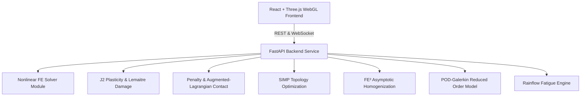

# Nonlinear FEA Studio (`nonlinear-fea-studio`)

[](https://github.com/DNV-Portfolio/nonlinear-fea-studio/actions)
[](LICENSE)
[](https://www.python.org/)
[](https://reactjs.org/)

**Project 2 — Nonlinear, Multiscale Computational Structural Mechanics Framework**  
*Portfolio Blueprint for Advanced Engineering & Research Roles (DNV / Classification Societies / Research Labs Alignment)*

`nonlinear-fea-studio` is an end-to-end, research-grade computational structural mechanics software platform. It escalates standard linear-elastic FEM into geometrically and materially nonlinear analysis, multiscale homogenization, topology optimization, reduced-order modeling, and probabilistic fatigue reliability.

---

## Key Features & Physics Scope

1. **Total & Updated Lagrangian Nonlinear FE Solver**: Green-Lagrange strain tensor $E = \frac{1}{2}(F^T F - I)$, 2nd Piola-Kirchhoff stress $S$, and tangent stiffness matrix $K_T = K_0 + K_\sigma$.
2. **Crisfield Arc-Length Continuation**: Traces post-buckling snap-through and snap-back equilibrium paths where conventional Newton-Raphson fails.
3. **J2 Plasticity & Lemaitre Continuum Damage**: Radial return algorithm for von Mises yield surface with isotropic/kinematic hardening and stiffness degradation $\dot{D}$.
4. **Augmented-Lagrangian Contact Mechanics**: Active-set gap detection ($g_n$) and frictional stick-slip contact forces.
5. **Zienkiewicz-Zhu (ZZ) Adaptive Mesh Refinement**: Superconvergent Patch Recovery (SPR) error estimation driving $h$-refinement remeshing.
6. **SIMP Topology Optimization with MMA**: Compliance minimization $c(\rho) = U^T K(\rho) U$, Helmholtz density filtering, additive manufacturing overhang constraints, and robust multi-load variants.
7. **$FE^2$ / Asymptotic Homogenization**: Periodic RVE homogenization for lattice infills & composite microstructures with Voigt, Reuss, and Hashin-Shtrikman bounds validation.
8. **Explicit Central-Difference Dynamics**: Central-difference explicit time integration with mass scaling and added-mass fluid-structure interaction (FSI) for marine slamming.
9. **POD-Galerkin Reduced-Order Model (ROM)**: Snapshot SVD mode extraction for sub-second online parameter sweep load sliders.
10. **Rainflow Fatigue & Reliability Engine**: ASTM E1049 Rainflow cycle counting, Palmgren-Miner cumulative damage law, and Monte Carlo reliability trajectory $\beta(t)$ & $P_f(t)$.

---

## Mandatory Light-Theme CAD User Interface

- **Forced Light Theme**: `#FAFBFC` background, `#FFFFFF` cards, `#1F4E79` primary accent, `#1A1A1A` text.
- **Three.js 3D WebGL Canvas**: Deformed mesh toggle, von Mises stress heatmaps, SIMP density maps, and interactive orbit controls.
- **Bottom Expandable Drawer**: Dynamic Recharts equilibrium path plots ($P-u$), SIMP compliance history, fatigue reliability curves, and real-time WebSocket log stream.

---

## Architecture Diagram



---

## Quick Start & Local Development

### 1. Backend Setup & Pytest Verification
```bash
cd backend
python -m pip install -r requirements.txt
pytest -v
python -m uvicorn fea.api.app:app --reload --port 8000
```

### 2. Frontend Development Server
```bash
cd frontend
npm install
npm run dev
```

### 3. Docker Compose Local Deployment
```bash
docker-compose -f infra/docker-compose.yml up --build
```

---

## License

This project is released under the [MIT License](LICENSE).
