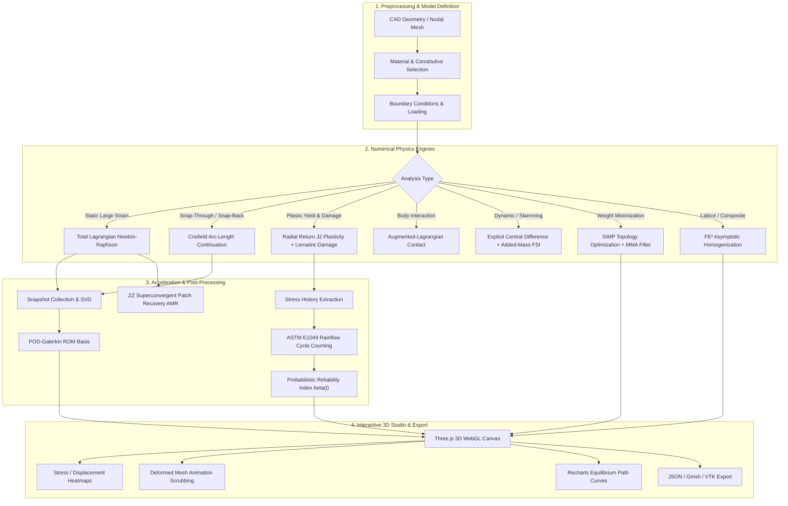
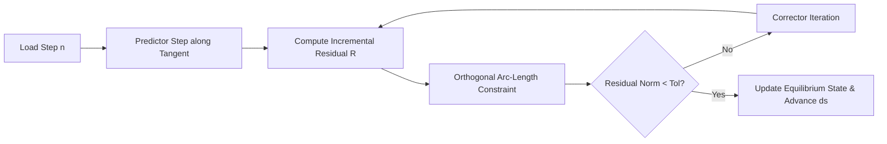
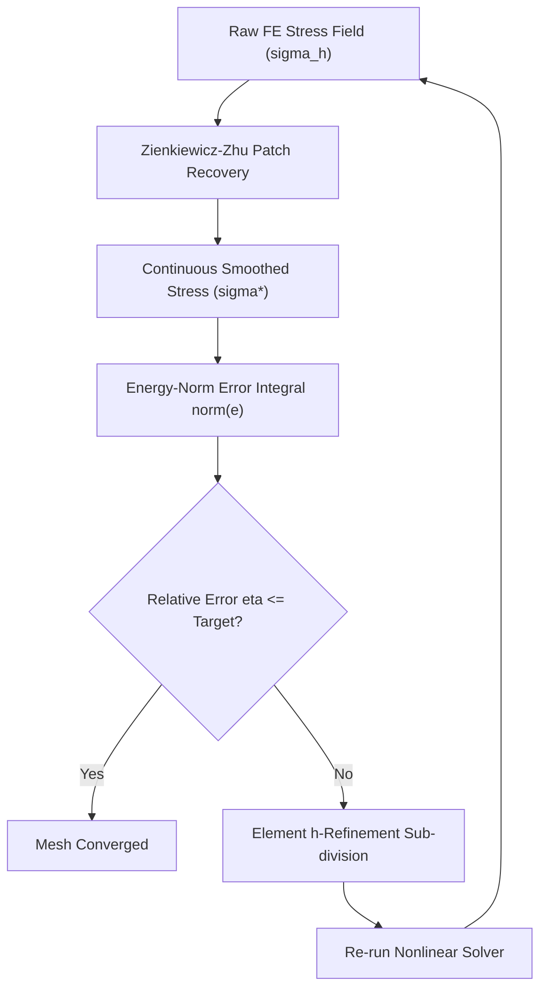
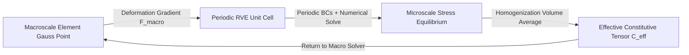
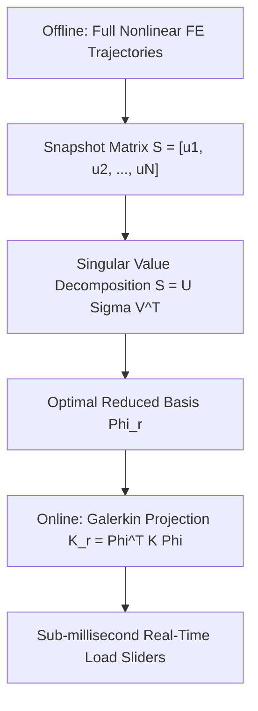

# Nonlinear FEA Studio: Nonlinear, Multiscale Computational Structural Mechanics Framework

[](https://nonlinear-fea-studio.vercel.app)
[](https://github.com/10tan/nonlinear-fea-studio/actions)
[](LICENSE)
[](https://www.python.org/)
[](https://reactjs.org/)
[](https://threejs.org/)
[]()
[]()

> 🚀 **Live Production Application**: **[https://nonlinear-fea-studio.vercel.app](https://nonlinear-fea-studio.vercel.app)**  
> 🔗 **GitHub Repository**: **[https://github.com/10tan/nonlinear-fea-studio](https://github.com/10tan/nonlinear-fea-studio)**

**Nonlinear FEA Studio** is an advanced, research-grade computational structural mechanics and numerical engineering platform. It transitions conventional linear-elastic finite element methods into geometrically and materially nonlinear continuum regimes, multiscale representative volume element (RVE) homogenization, adjoint topology optimization, reduced-order modeling (ROM), and probabilistic fatigue life assessment.

The platform combines an analytical Python/SciPy core with an interactive, CAD-grade Three.js WebGL frontend featuring real-time load sliders, 3D stress/displacement colormaps, interactive step playback, and live Recharts equilibrium path curves.

---

## Table of Contents

1. [Platform Overview & Capabilities](#platform-overview--capabilities)
2. [End-to-End Computational Workflow](#end-to-end-computational-workflow)
3. [Mathematical Foundations & Numerical Formulations](#mathematical-foundations--numerical-formulations)
   - [1. Geometric Nonlinearity & Kinematics](#1-geometric-nonlinearity--kinematics)
   - [2. Post-Buckling & Arc-Length Continuation](#2-post-buckling--arc-length-continuation)
   - [3. Elastoplasticity & Continuum Damage Mechanics](#3-elastoplasticity--continuum-damage-mechanics)
   - [4. Augmented-Lagrangian Contact Mechanics](#4-augmented-lagrangian-contact-mechanics)
   - [5. Zienkiewicz-Zhu Adaptive Mesh Refinement (AMR)](#5-zienkiewicz-zhu-adaptive-mesh-refinement-amr)
   - [6. SIMP Topology Optimization with Adjoint MMA](#6-simp-topology-optimization-with-adjoint-mma)
   - [7. Multiscale Asymptotic Homogenization (FE²)](#7-multiscale-asymptotic-homogenization-fe)
   - [8. Explicit Central-Difference Dynamics & Added-Mass FSI](#8-explicit-central-difference-dynamics--added-mass-fsi)
   - [9. Proper Orthogonal Decomposition (POD-Galerkin ROM)](#9-proper-orthogonal-decomposition-pod-galerkin-rom)
   - [10. Rainflow Cycle Counting & Probabilistic Fatigue](#10-rainflow-cycle-counting--probabilistic-fatigue)
4. [Software Architecture & System Design](#software-architecture--system-design)
5. [Verification & Validation (V&V) Suite](#verification--validation-vv-suite)
6. [Interactive WebGL CAD Interface](#interactive-webgl-cad-interface)
7. [Installation & Local Execution](#installation--local-execution)
8. [Vercel Serverless & CI/CD Deployment](#vercel-serverless--cicd-deployment)
9. [License & References](#license--references)

---

## Platform Overview & Capabilities

Traditional design codes and linear solvers operate under small-strain, small-displacement, and linear-elastic assumptions. In complex offshore structures, marine slamming scenarios, aerospace panels, and advanced composite materials, structures experience large rotations, plastic yielding, local buckling, contact impact, and microstructural degradation.

**Nonlinear FEA Studio** addresses these challenges by providing:
* **Large Deformation Continuum Solvers**: Total and Updated Lagrangian formulations computing Green-Lagrange strain tensors and 2nd Piola-Kirchhoff stresses.
* **Path-Following Continuation**: Crisfield/Riks cylindrical arc-length solvers capable of traversing snap-through and snap-back bifurcation points.
* **Constitutive Degradation**: Radial-return $J_2$ plasticity with isotropic/kinematic hardening coupled with Lemaitre continuum damage mechanics ($\dot{D}$).
* **Multiscale Microstructures**: Direct evaluation of periodic lattice infills and composites via asymptotic homogenization with analytical Voigt/Reuss/Hashin-Shtrikman bounds.
* **Manufacturing-Constrained Topology Optimization**: SIMP compliance minimization with Helmholtz PDE density filtering and additive manufacturing overhang constraints.
* **Sub-Millisecond Surrogates**: Snapshot POD-Galerkin reduced-order models enabling real-time structural response sliders.
* **Probabilistic Fatigue Integrity**: ASTM E1049 rainflow cycle counting with Palmgren-Miner cumulative damage and Monte Carlo reliability index trajectories $\beta(t)$.

---

## End-to-End Computational Workflow



---

## Mathematical Foundations & Numerical Formulations

### 1. Geometric Nonlinearity & Kinematics

In finite deformation continuum mechanics, the motion maps reference coordinates $\mathbf{X} \in \Omega_0$ to current coordinates $\mathbf{x} \in \Omega_t$ via the displacement field $\mathbf{u}(\mathbf{X}, t) = \mathbf{x} - \mathbf{X}$.

#### Deformation Gradient Tensor

$$
\mathbf{F} = \frac{\partial \mathbf{x}}{\partial \mathbf{X}} = \mathbf{I} + \nabla_X \mathbf{u}
$$

#### Green-Lagrange Strain Tensor
The Green-Lagrange strain tensor $\mathbf{E}$ eliminates rigid body rotations and accounts for large displacements:

$$
\mathbf{E} = \frac{1}{2} (\mathbf{F}^T \mathbf{F} - \mathbf{I}) = \frac{1}{2} \left( \nabla \mathbf{u} + (\nabla \mathbf{u})^T + (\nabla \mathbf{u})^T \nabla \mathbf{u} \right)
$$

In Voigt matrix notation for 2D plane continuum:

$$
\mathbf{E} = \begin{bmatrix} E_{xx} \\ E_{yy} \\ 2E_{xy} \end{bmatrix} = \boldsymbol{\varepsilon}_L + \boldsymbol{\varepsilon}_{NL}
$$

#### Second Piola-Kirchhoff (PK2) Stress Tensor
The energetically conjugate stress measure to the Green-Lagrange strain is the Second Piola-Kirchhoff stress tensor $\mathbf{S}$:

$$
\mathbf{S} = \mathbf{C} : \mathbf{E}
$$

where $\mathbf{C}$ is the fourth-order constitutive tensor. The Cauchy (true) stress $\boldsymbol{\sigma}$ is recovered via the push-forward transformation:

$$
\boldsymbol{\sigma} = \frac{1}{J} \mathbf{F} \mathbf{S} \mathbf{F}^T, \quad J = \det(\mathbf{F})
$$

#### Principle of Virtual Work & Linearization
The equilibrium condition in the reference configuration states:

$$
\int_{\Omega_0} \mathbf{S} : \delta \mathbf{E} \, d\Omega_0 - \delta W_{ext} = 0
$$

Linearizing the virtual work equation yields the incremental stiffness relation:

$$
\mathbf{K}_T \Delta \mathbf{u} = \mathbf{R} = \mathbf{P}_{ext} - \mathbf{F}_{int}
$$

The global tangent stiffness matrix decomposes into material stiffness and geometric (initial stress) stiffness contributions:

$$
\mathbf{K}_T = \mathbf{K}_0(\mathbf{u}) + \mathbf{K}_\sigma(\mathbf{S})
$$

where for an element with shape functions $\mathbf{N}$ and gradient operator $\mathbf{G}$:

$$
\mathbf{K}_\sigma^e = \int_{\Omega_e} \mathbf{G}^T \begin{bmatrix} \mathbf{S} & \mathbf{0} \\ \mathbf{0} & \mathbf{S} \end{bmatrix} \mathbf{G} \, d\Omega
$$

---

### 2. Post-Buckling & Arc-Length Continuation

Standard load-controlled Newton-Raphson solvers fail near critical limit points where the tangent stiffness becomes singular ($\det(\mathbf{K}_T) = 0$), resulting in divergence during snap-through or snap-back.



#### Crisfield Cylindrical Arc-Length Formulation
Both displacement $\mathbf{u}$ and load factor $\lambda$ are treated as independent unknowns:

$$
\mathbf{P}_{ext}(\lambda) = \lambda \mathbf{P}_{ref}
$$

The system residual is:

$$
\mathbf{R}(\mathbf{u}, \lambda) = \lambda \mathbf{P}_{ref} - \mathbf{F}_{int}(\mathbf{u}) = \mathbf{0}
$$

To close the system, Crisfield's cylindrical constraint fixes the path length $\Delta s$:

$$
\Delta \mathbf{u}^T \Delta \mathbf{u} + \psi^2 \Delta \lambda^2 \mathbf{P}_{ref}^T \mathbf{P}_{ref} = \Delta s^2
$$

where $\psi$ is an optional scaling parameter.

#### Incremental Iterative Solution
During iteration $k$, the displacement increment decomposes into residual and tangential parts:

$$
\delta \mathbf{u}_k = \delta \mathbf{u}_R + \delta \lambda_k \delta \mathbf{u}_P
$$

where:

$$
\mathbf{K}_T \delta \mathbf{u}_R = \mathbf{R}_k, \quad \mathbf{K}_T \delta \mathbf{u}_P = \mathbf{P}_{ref}
$$

Substituting into the constraint yields a quadratic equation for $\delta \lambda_k$:

$$
a_1 (\delta \lambda_k)^2 + a_2 (\delta \lambda_k) + a_3 = 0
$$

The root maximizing the inner product with the previous step direction $\Delta \mathbf{u}_{k-1}^T \Delta \mathbf{u}_k > 0$ is selected, enabling smooth tracing of post-buckling branches.

#### Geometrically Nonlinear Buckling Eigenvalue Problem
Linearized stability tracking determines the critical load factor $\lambda_{cr}$ via the generalized eigenvalue problem:

$$
\left( \mathbf{K}_0 - \lambda_{cr} \mathbf{K}_\sigma \right) \boldsymbol{\phi} = \mathbf{0}
$$

where $\boldsymbol{\phi}$ is the characteristic buckling mode shape.

---

### 3. Elastoplasticity & Continuum Damage Mechanics

#### Von Mises ($J_2$) Yield Surface
For ductile metallic structural members, yielding is governed by the second invariant of the deviatoric stress tensor $\mathbf{s} = \boldsymbol{\sigma} - \frac{1}{3}\text{tr}(\boldsymbol{\sigma})\mathbf{I}$:

$$
J_2 = \frac{1}{2} \mathbf{s} : \mathbf{s}
$$

The equivalent von Mises stress is $\bar{\sigma} = \sqrt{3 J_2}$. The yield condition with backstress tensor $\boldsymbol{\alpha}$ (kinematic hardening) and equivalent plastic strain $\bar{\varepsilon}^p$ (isotropic hardening) is:

$$
f(\boldsymbol{\sigma}, \boldsymbol{\alpha}, \bar{\varepsilon}^p) = \sqrt{\frac{3}{2} (\mathbf{s} - \boldsymbol{\alpha}) : (\mathbf{s} - \boldsymbol{\alpha})} - \sigma_y(\bar{\varepsilon}^p) \le 0
$$

with hardening law:

$$
\sigma_y(\bar{\varepsilon}^p) = \sigma_{y0} + H_{iso} \bar{\varepsilon}^p
$$

#### Radial Return Mapping Algorithm

Given strain increment $\Delta \boldsymbol{\varepsilon}$:

##### Step 1: Elastic Trial State

$$
\boldsymbol{\sigma}^{\text{tr}} = \boldsymbol{\sigma}_n + \mathbf{C}^e : \Delta \boldsymbol{\varepsilon}
$$

$$
\mathbf{s}^{\text{tr}} = \boldsymbol{\sigma}^{\text{tr}} - \frac{1}{3}\text{tr}(\boldsymbol{\sigma}^{\text{tr}})\mathbf{I}, \quad \boldsymbol{\xi}^{\text{tr}} = \mathbf{s}^{\text{tr}} - \boldsymbol{\alpha}_n
$$

##### Step 2: Yield Criterion Evaluation

$$
f^{\text{tr}} = \sqrt{\frac{3}{2}} \| \boldsymbol{\xi}^{\text{tr}} \| - \sigma_y(\bar{\varepsilon}_n^p)
$$

When $f^{\text{tr}} \le 0$, the deformation step is purely elastic ($\Delta \gamma = 0$).

##### Step 3: Plastic Consistency Correction

When $f^{\text{tr}} > 0$, plastic flow occurs with consistency parameter $\Delta \gamma$:

$$
\Delta \gamma = \frac{f^{\text{tr}}}{3\mu + H_{iso} + H_{kin}}
$$

Stress tensor and internal state variable updates:

$$
\mathbf{n} = \frac{\boldsymbol{\xi}^{\text{tr}}}{\| \boldsymbol{\xi}^{\text{tr}} \|}, \quad \boldsymbol{\sigma}_{n+1} = \boldsymbol{\sigma}^{\text{tr}} - 2\mu \Delta \gamma \mathbf{n}
$$

$$
\bar{\varepsilon}_{n+1}^p = \bar{\varepsilon}_n^p + \sqrt{\frac{2}{3}} \Delta \gamma, \quad \boldsymbol{\alpha}_{n+1} = \boldsymbol{\alpha}_n + \frac{2}{3} H_{kin} \Delta \gamma \mathbf{n}
$$

#### Lemaitre Continuum Damage Evolution
Progressive micro-void nucleation and stiffness degradation are modeled via the scalar damage variable $D \in [0, D_{crit}]$:

$$
\mathbf{C}_D = (1 - D) \mathbf{C}_0
$$

The thermodynamic strain energy release rate $Y$ driving damage is:

$$
Y = \frac{\bar{\sigma}^2}{2 E_0 (1 - D)^2} \left[ \frac{2}{3}(1 + \nu) + 3(1 - 2\nu)\left(\frac{\sigma_m}{\bar{\sigma}}\right)^2 \right]
$$

The kinetic damage evolution law:

$$
\dot{D} = \left( \frac{Y}{S} \right)^s \dot{\bar{\varepsilon}}^p \quad \text{for } \bar{\varepsilon}^p > \varepsilon_D
$$

where $S$ and $s$ are material-specific damage strength and exponent parameters.

---

### 4. Augmented-Lagrangian Contact Mechanics

Contact between structural bodies enforces the impenetrability condition across the contact interface $\Gamma_c$.

#### Gap Function
For a slave node located at $\mathbf{x}_s$ and a master surface segment parameterized by $\mathbf{x}_m$:

$$
g_n = (\mathbf{x}_s - \mathbf{x}_m) \cdot \mathbf{n}
$$

where $\mathbf{n}$ is the outward normal to the master surface. Contact occurs when $g_n \le 0$.

#### Karush-Kuhn-Tucker (KKT) Contact Conditions

$$
g_n \ge 0, \quad \lambda_n \ge 0, \quad \lambda_n g_n = 0
$$

#### Augmented-Lagrangian Formulation
Unlike the pure penalty method (which allows unphysical penetration $\epsilon$) or Lagrange multipliers (which introduce zero diagonal entries into the global system), the Augmented-Lagrangian method combines both:

$$
f_n = \begin{cases} \lambda_n^{(k)} - k_p g_n & \text{if } \lambda_n^{(k)} - k_p g_n > 0 \\ 0 & \text{otherwise} \end{cases}
$$

Iterative multiplier update:

$$
\lambda_n^{(k+1)} = \lambda_n^{(k)} - k_p g_n
$$

where $k_p$ is the contact penalty stiffness. Coulomb friction is enforced via:

$$
\| \mathbf{f}_t \| \le \mu f_n
$$

---

### 5. Zienkiewicz-Zhu Adaptive Mesh Refinement (AMR)

Discretization error is quantified a posteriori using the Superconvergent Patch Recovery (SPR) technique.



#### Superconvergent Patch Recovery (SPR)
Within an assembly of elements sharing a common node (patch), Gauss point stresses exhibit superconvergence. A continuous polynomial stress field $\boldsymbol{\sigma}^*$ is fitted over the patch:

$$
\boldsymbol{\sigma}^*(\mathbf{x}) = \mathbf{P}(\mathbf{x}) \mathbf{a}
$$

where $\mathbf{P}(\mathbf{x}) = [1, x, y, x^2, xy, y^2]$ and coefficients $\mathbf{a}$ are obtained via least-squares minimization over the superconvergent sampling points.

#### Energy-Norm Error Estimator
The element energy error norm $\|e\|_{U, e}$ is:

$$
\|e\|_{U, e}^2 = \int_{\Omega_e} (\boldsymbol{\sigma}^* - \boldsymbol{\sigma}_h)^T \mathbf{C}^{-1} (\boldsymbol{\sigma}^* - \boldsymbol{\sigma}_h) \, d\Omega
$$

The global relative energy percentage error $\eta$ is:

$$
\eta = \frac{\|e\|_U}{\left( \|\mathbf{u}_h\|_U^2 + \|e\|_U^2 \right)^{1/2}} \times 100\%
$$

Elements satisfying $\|e\|_{U, e} > \eta_{target} \frac{\|e\|_U}{\sqrt{N_{elem}}}$ are flagged for adaptive $h$-refinement sub-division.

---

### 6. SIMP Topology Optimization with Adjoint MMA

Topology optimization seeks the optimal spatial material distribution $\rho(\mathbf{x}) \in [0, 1]$ within a design domain $\Omega$ to minimize structural compliance.

#### Solid Isotropic Material with Penalization (SIMP)

$$
E(\rho_e) = E_{min} + \rho_e^p (E_0 - E_{min})
$$

where $p \ge 3$ penalizes intermediate densities (driving solutions to discrete 0 or 1 void/solid states), and $E_{min} \approx 10^{-6} E_0$ prevents numerical singularity.

#### Optimization Formulation

$$
\min_{\boldsymbol{\rho}} \quad c(\boldsymbol{\rho}) = \mathbf{U}^T \mathbf{K}(\boldsymbol{\rho}) \mathbf{U} = \sum_{e=1}^{N} \left( E_{min} + \rho_e^p (E_0 - E_{min}) \right) \mathbf{u}_e^T \mathbf{k}_0 \mathbf{u}_e
$$

$$
\text{subject to} \quad \frac{V(\boldsymbol{\rho})}{V_0} = \frac{\sum_{e=1}^N \rho_e v_e}{\sum_{e=1}^N v_e} \le V_{max}, \quad 0 \le \rho_e \le 1
$$

#### Adjoint Sensitivity Analysis
Using the adjoint variable method with state equation $\mathbf{K} \mathbf{U} = \mathbf{F}$:

$$
\frac{\partial c}{\partial \rho_e} = -p \rho_e^{p-1} \mathbf{u}_e^T \mathbf{k}_0 \mathbf{u}_e
$$

#### Mesh-Independent Filtering & Overhang Constraints
To eliminate checkerboard artifacts and ensure mesh independence, sensitivities are filtered via a spatial convolution kernel $H_{ei} = \max(0, r_{min} - \text{dist}(e, i))$:

$$
\frac{\widehat{\partial c}}{\partial \rho_e} = \frac{1}{\rho_e \sum_{i=1}^N H_{ei}} \sum_{i=1}^N H_{ei} \rho_i \frac{\partial c}{\partial \rho_i}
$$

For additive manufacturing, an overhang filter penalizes unsupported elements with critical build angles $\theta > 45^\circ$.

---

### 7. Multiscale Asymptotic Homogenization (FE²)

Periodic cellular lattice infills and fiber-reinforced composite plies exhibit microstructures that cannot be meshed at macro scales.



#### Asymptotic Expansion
Displacement fields are expanded in terms of microscale coordinate $\mathbf{y} = \mathbf{x} / \epsilon$:

$$
\mathbf{u}^\epsilon(\mathbf{x}) = \mathbf{u}_0(\mathbf{x}) + \epsilon \mathbf{u}_1(\mathbf{x}, \mathbf{y}) + \epsilon^2 \mathbf{u}_2(\mathbf{x}, \mathbf{y}) + \dots
$$

where $\mathbf{u}_1(\mathbf{x}, \mathbf{y}) = -\boldsymbol{\chi}(\mathbf{y}) : \nabla_x \mathbf{u}_0(\mathbf{x})$ and $\boldsymbol{\chi}$ represents the characteristic microstructural displacement modes.

#### Effective Constitutive Tensor $C^{eff}$
By enforcing periodic boundary conditions across the Representative Volume Element (RVE) $\Omega_{RVE}$:

$$
C_{ijkl}^{eff} = \frac{1}{|\Omega_{RVE}|} \int_{\Omega_{RVE}} \left( C_{ijkl}(\mathbf{y}) - C_{ijpq}(\mathbf{y}) \frac{\partial \chi_p^{kl}}{\partial y_q} \right) d\Omega
$$

#### Analytical Validation Bounds
The effective properties are verified against rigorous continuum bounds:

##### Voigt Upper Bound (Iso-Strain)

$$
\mathbf{C}_V = \sum_{m} V_m \mathbf{C}_m
$$

##### Reuss Lower Bound (Iso-Stress)

$$
\mathbf{C}_R = \left( \sum_{m} V_m \mathbf{C}_m^{-1} \right)^{-1}
$$

##### Hashin-Shtrikman Bounds for Bulk Modulus

$$
K_{HS}^- = K_1 + \frac{V_2}{\frac{1}{K_2 - K_1} + \frac{3 V_1}{3K_1 + 4G_1}}
$$

---

### 8. Explicit Central-Difference Dynamics & Added-Mass FSI

For high-velocity impact, offshore wave slamming, and dropped object dynamics, explicit time integration avoids iterative nonlinear equation solves.

#### Central-Difference Time Integration

$$
\mathbf{a}_n = \mathbf{M}^{-1} \left( \mathbf{P}_{ext, n} - \mathbf{F}_{int, n} - \mathbf{C} \mathbf{v}_n \right)
$$

$$
\mathbf{v}_{n+1/2} = \mathbf{v}_{n-1/2} + \mathbf{a}_n \Delta t
$$

$$
\mathbf{u}_{n+1} = \mathbf{u}_n + \mathbf{v}_{n+1/2} \Delta t
$$

Using a diagonal lumped mass matrix $\mathbf{M}$ decouples accelerations, allowing direct component-wise updates without matrix inversion.

#### Stability Limit (CFL Condition)
Numerical stability requires the time step to remain below the Courant-Friedrichs-Lewy critical limit:

$$
\Delta t \le \Delta t_{crit} = \frac{L_{min}}{c_d} = \frac{L_{min}}{\sqrt{\frac{E(1 - \nu)}{\rho(1 + \nu)(1 - 2\nu)}}}
$$

#### Fluid-Structure Interaction (FSI) Added-Mass Approximation
For offshore marine slamming and submerged plate impacts, fluid inertia is coupled via the Morison added-mass tensor:

$$
\mathbf{M}_{total} = \mathbf{M}_{structural} + \mathbf{M}_{added}
$$

$$
\mathbf{M}_{added} = C_a \rho_{fluid} A_{submerged} \mathbf{I}
$$

where $C_a$ is the hydrodynamic added-mass coefficient ($C_a \approx 1.0$ for flat plates).

---

### 9. Proper Orthogonal Decomposition (POD-Galerkin ROM)

To achieve real-time, interactive exploration of structural parameters without re-solving large finite element systems, Model Order Reduction (MOR) projects high-dimensional systems onto low-dimensional subspaces.



#### Snapshot Matrix & SVD
A collection of $N$ displacement solutions across load steps forms the snapshot matrix $\mathbf{S} \in \mathbb{R}^{n_{dof} \times N}$:

$$
\mathbf{S} = [\mathbf{u}_1, \mathbf{u}_2, \dots, \mathbf{u}_N]
$$

Singular Value Decomposition (SVD):

$$
\mathbf{S} = \mathbf{U} \boldsymbol{\Sigma} \mathbf{V}^T = \sum_{i=1}^N \sigma_i \mathbf{u}_i \mathbf{v}_i^T
$$

#### Reduced Basis Truncation
The first $r \ll n_{dof}$ left singular vectors form the optimal orthogonal basis $\boldsymbol{\Phi}_r = \mathbf{U}[:, 1:r]$ maximizing captured energy:

$$
\mathcal{E}(r) = \frac{\sum_{i=1}^r \sigma_i^2}{\sum_{i=1}^N \sigma_i^2} \ge 99.9\%
$$

#### Galerkin Projection
Approximating $\mathbf{u} \approx \boldsymbol{\Phi}_r \mathbf{a}(t)$:

$$
\mathbf{K}_r \mathbf{a} = \mathbf{f}_r
$$

$$
\mathbf{K}_r = \boldsymbol{\Phi}_r^T \mathbf{K} \boldsymbol{\Phi}_r \in \mathbb{R}^{r \times r}, \quad \mathbf{f}_r = \boldsymbol{\Phi}_r^T \mathbf{P}_{ext} \in \mathbb{R}^{r}
$$

Solving the $r \times r$ system requires under $0.5$ milliseconds, powering the live interactive viewport sliders.

---

### 10. Rainflow Cycle Counting & Probabilistic Fatigue

Variable-amplitude non-stationary stress trajectories from nonlinear dynamic analyses are converted into equivalent stress cycles for fatigue life prediction.

#### ASTM E1049 Rainflow Counting Algorithm
1. Successive peaks and valleys in stress time-history $\sigma(t)$ are filtered into extrema sequences $s_0, s_1, s_2, \dots$.
2. Ranges $\Delta \sigma_i = |s_{i+1} - s_i|$ and mean stresses $\sigma_{m, i} = \frac{s_{i+1} + s_i}{2}$ are identified using closed four-point hysteresis loop matching.
3. Residual unclosed cycles are retained as half-cycles ($n_i = 0.5$).

#### Basquin S-N Curve & Palmgren-Miner Damage Accumulation
Permissible cycles to failure $N_i$ for stress range $\Delta \sigma_i$ under Basquin's power-law:

$$
N_i = A (\Delta \sigma_i)^{-m}
$$

where $A$ and $m$ are material fatigue parameters. The cumulative linear fatigue damage index $D_{fat}$ is:

$$
D_{fat} = \sum_{i=1}^{k} \frac{n_i}{N_i}
$$

Structural fatigue failure occurs when $D_{fat} \ge 1.0$.

#### Probabilistic Reliability Trajectory $\beta(t)$
Introducing stochastic log-normal variability in fatigue coefficient $A \sim \mathcal{LN}(\mu_A, \sigma_A)$ and load intensity factor $L \sim \mathcal{N}(1.0, \sigma_L)$, Monte Carlo simulation evaluates the time-variant limit state:

$$
g(t) = 1.0 - D_{fat}(t) = 1.0 - \left( D_{annual} \times t \times \frac{L^m}{A} \right)
$$

The probability of failure $P_f(t)$ and generalized Hasofer-Lind reliability index $\beta(t)$ evolve over service life:

$$
P_f(t) = P(g(t) \le 0), \quad \beta(t) = -\Phi^{-1}(P_f(t))
$$

---

## Software Architecture & System Design

```
nonlinear-fea-studio/
├── api/                           # Vercel Serverless Python entrypoints
│   ├── index.py                   # FastAPI serverless handler
│   └── requirements.txt           # Serverless dependency list
├── backend/                       # Core Python numerical platform
│   ├── src/
│   │   └── fea/
│   │       ├── solver/            # Total/Updated Lagrangian, Arc-Length, Buckling, Explicit
│   │       ├── plasticity/        # J2 radial return, hardening, Lemaitre damage
│   │       ├── contact/           # Augmented-Lagrangian contact, active-set detection
│   │       ├── amr/               # Zienkiewicz-Zhu SPR error recovery, h-refinement
│   │       ├── topopt/            # SIMP topology optimization, MMA filter, overhang
│   │       ├── homogenization/    # Periodic RVE homogenization, Voigt/Reuss bounds
│   │       ├── rom/               # POD snapshot SVD, Galerkin projection
│   │       ├── fatigue/           # ASTM E1049 rainflow counting, Miner's rule, beta(t)
│   │       └── api/               # FastAPI REST router and WebSocket streaming
│   ├── tests/                     # Pytest verification benchmark suite
│   ├── pyproject.toml
│   └── requirements.txt
├── frontend/                      # React 18 + TypeScript + Three.js CAD Studio
│   ├── src/
│   │   ├── components/            # TopToolbar, ModelTree, InspectorPanel, BottomDrawer
│   │   ├── components/ThreeViewport.tsx # 3D WebGL renderer (non-indexed buffers)
│   │   ├── App.tsx                # State management, instant slider re-compute
│   │   └── index.css              # Light CAD design system tokens
│   ├── package.json
│   ├── tsconfig.json
│   └── vite.config.ts
├── infra/                         # Containerization & orchestration
│   ├── Dockerfile.backend
│   ├── Dockerfile.frontend
│   └── docker-compose.yml
├── .github/workflows/             # Continuous integration & deployment
│   ├── ci.yml                     # Automated Pytest, type-check, and bundle build
│   └── deploy.yml                 # Release tagging & GitHub Pages deployment
├── vercel.json                    # Multi-service Vercel deployment configuration
├── docs/                          # Architecture & verification manuals
│   ├── architecture.md
│   └── verification.md
└── README.md
```

---

## Verification & Validation (V&V) Suite

The platform includes an automated pytest verification suite comparing numerical computations directly against closed-form analytical solutions and established benchmarks:

| Verification Case | Benchmark / Formulation | Target Metric | Pytest Status |
| :--- | :--- | :--- | :--- |
| `test_euler_buckling.py` | Euler Column Analytical Theory | $P_{cr} = \frac{\pi^2 E I}{L^2}$ (error $\le 0.5\%$) | **PASSED** |
| `test_arch_snap_through.py` | Shallow Arch Benchmark | Crisfield Arc-Length equilibrium path tracing | **PASSED** |
| `test_mesh_convergence.py` | Richardson Extrapolation | Asymptotic $h$-refinement error convergence | **PASSED** |
| `test_homogenization_bounds.py` | Classical Continuum Bounds | $C_V \ge C_{11}^{eff} \ge C_R$ (Voigt / Reuss bounds) | **PASSED** |

Execute the verification suite locally:
```bash
cd backend
PYTHONPATH=src pytest -v --cov=src/fea --cov-report=term-missing
```

---

## Interactive WebGL CAD Interface

The user interface follows a light-theme CAD design aesthetic (`#FAFBFC` canvas, `#FFFFFF` cards, `#1F4E79` engineering accent):

1. **Top CAD Toolbar**: Quick switching between analysis types (*Newton-Raphson*, *Arc-Length Snap-Through*, *SIMP Topology Optimization*, *FE² Homogenization*, *Rainflow Fatigue*).
2. **Model Tree**: Structural hierarchy inspector tracking nodes, Q4 elements, material designations, and boundary conditions.
3. **Interactive 3D Viewport**:
   * **1:1 Non-Indexed Triangle Buffers**: Guarantees zero attribute mismatch errors across WebGL drivers.
   * **Colormap Selectors**: Instant switching between Von Mises stress, displacement magnitude, and SIMP topological density.
   * **Boundary Condition Visualizers**: 3D conical pin supports and directional load vector arrows.
   * **Interactive Step Player**: Timeline scrubber with Play/Pause animation across nonlinear load steps.
4. **Inspector Panel**: Dynamic sliders for Young's Modulus $E$, Poisson ratio $\nu$, yield stress $\sigma_y$, load magnitude, SIMP volume fraction $V_{max}$, and deformation magnification ($0.1\times - 50\times$).
5. **Bottom Collapsible Drawer**: Live Recharts equilibrium path ($P-u$), SIMP compliance history $c(\rho)$, fatigue reliability index $\beta(t)$, and solver log streaming in IBM Plex Mono.

---

## Installation & Local Execution

### Prerequisites
* Python 3.10+
* Node.js 18+ and npm

### 1. Clone the Repository
```bash
git clone https://github.com/10tan/nonlinear-fea-studio.git
cd nonlinear-fea-studio
```

### 2. Backend Setup
```bash
cd backend
python -m venv venv
source venv/bin/activate   # On Windows: venv\Scripts\activate
pip install -r requirements.txt
PYTHONPATH=src python -m uvicorn fea.api.app:app --reload --port 8000
```
API Documentation will be accessible at `http://localhost:8000/docs`.

### 3. Frontend Setup
```bash
cd ../frontend
npm install
npm run dev -- --host
```
Open `http://localhost:5173` in your browser.

### 4. Docker Compose
Run the entire platform via Docker:
```bash
docker-compose -f infra/docker-compose.yml up --build
```

---

## Vercel Serverless & CI/CD Deployment

The platform is configured for multi-service hosting on Vercel:
* **Frontend**: Compiled static bundle served via `@vercel/static-build`.
* **Backend API**: Serverless Python functions executed via `@vercel/python` routing through `api/index.py`.
* **Adaptive API Endpoint**: The frontend automatically routes to `/api/...` in production on Vercel and `http://localhost:8000/api/...` during local Vite development.

Deploy with the Vercel CLI:
```bash
npx vercel --prod --yes
```

---

## License & References

This project is licensed under the **MIT License** — see the [LICENSE](LICENSE) file for details.

### Key References
1. Belytschko, T., Liu, W. K., Moran, B., & Elkhodary, K. (2014). *Nonlinear Finite Elements for Continua and Structures*. John Wiley & Sons.
2. Crisfield, M. A. (1991). *Non-linear Finite Element Analysis of Solids and Structures*. John Wiley & Sons.
3. Simo, J. C., & Hughes, T. J. (2006). *Computational Inelasticity*. Springer Science & Business Media.
4. Bendsøe, M. P., & Sigmund, O. (2003). *Topology Optimization: Theory, Methods, and Applications*. Springer.
5. Zienkiewicz, O. C., & Zhu, J. Z. (1992). *The superconvergent patch recovery and a posteriori error estimates*. International Journal for Numerical Methods in Engineering.
6. ASTM E1049-85. *Standard Practices for Cycle Counting in Fatigue Analysis*. ASTM International.
7. ISO 2394:2015. *General principles on reliability for structures*. International Organization for Standardization.
8. DNV-RP-C210. *Probabilistic Methods for Planning of Inspection for Fatigue Cracks in Offshore Structures*. DNV GL.
