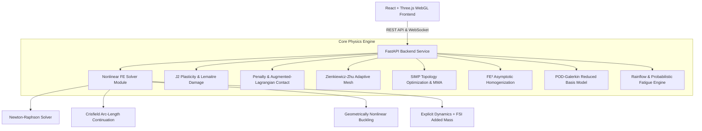

# System Architecture & Component Design

**`nonlinear-fea-studio`** is organized into a modular Python high-performance core and a light-theme WebGL Three.js user interface.

## System Architecture Diagram

## Core Engine Modules

1. **`fea.solver`**: Total/Updated Lagrangian 2D/3D continuum solver with Green-Lagrange strain tensor $E$, 2nd Piola-Kirchhoff stress $S$, tangent matrix $K_T = K_0 + K_\sigma$, Crisfield Arc-Length continuation, and explicit dynamic integration.
2. **`fea.plasticity`**: Radial return mapping for J2 von Mises yield surface, isotropic/kinematic hardening, and Lemaitre continuum damage $\dot{D}$.
3. **`fea.contact`**: Active-set penetration detection and Augmented-Lagrangian contact enforcement.
4. **`fea.amr`**: Superconvergent Patch Recovery (SPR) of stress fields and $L_2$-norm energy error estimation $\|e\|_U$.
5. **`fea.topopt`**: SIMP material penalization, Adjoint sensitivity analysis, Optimality Criteria (OC), density filtering, and robust multi-load optimization.
6. **`fea.homogenization`**: $FE^2$ periodic RVE homogenization computing effective $C^{eff}$ and checking analytical Voigt/Reuss/Hashin-Shtrikman bounds.
7. **`fea.rom`**: Snapshot SVD mode extraction and Galerkin projection for sub-second online parameter sweep response.
8. **`fea.fatigue`**: ASTM E1049 Rainflow cycle counting, Palmgren-Miner damage accumulation, and Monte Carlo reliability index $\beta(t)$ trajectory generation.
